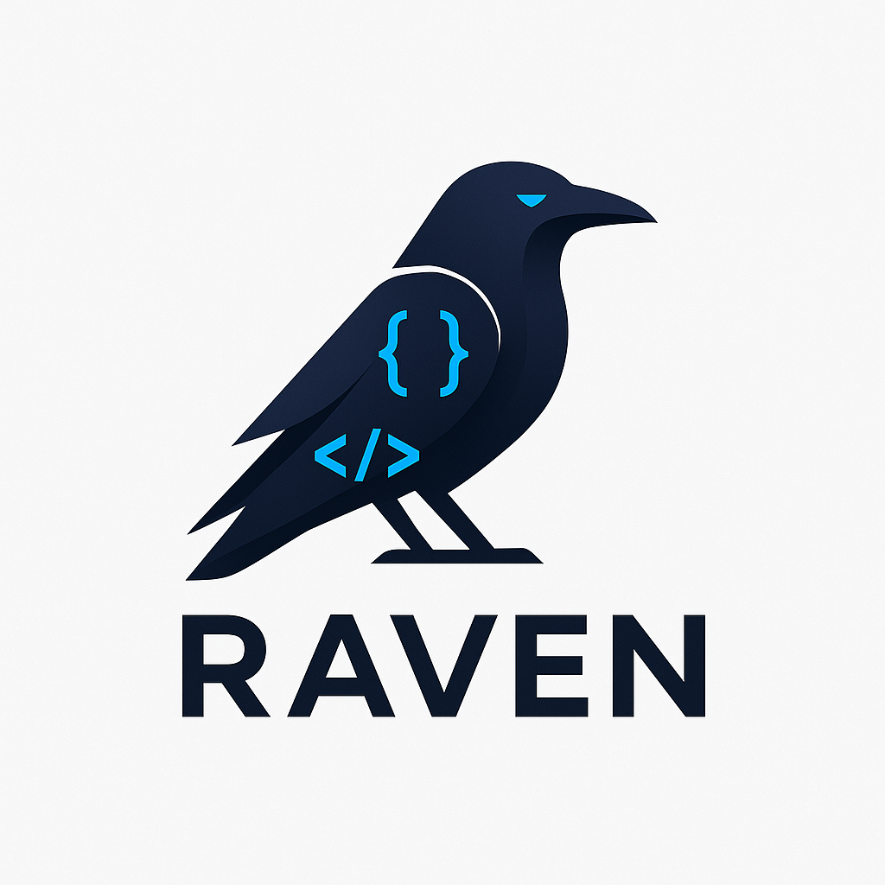

<p align="center">
  
</p>

<p align="center">
  A modern programming language built with Rust.<br/>
  Fast, safe, expressive, and easy to read.
</p>

<p align="center">
  <a href="https://github.com/martian56/raven/actions/workflows/ci.yml"></a>
  <a href="https://github.com/martian56/raven/releases"></a>
  <a href="https://github.com/martian56/raven/blob/main/LICENSE"></a>
  <a href="https://marketplace.visualstudio.com/items?itemName=martian56.raven-language"></a>
</p>

<p align="center">
  <a href="https://martian56.github.io/raven/">Documentation</a>
  &middot;
  <a href="https://raven.ufazien.com/">Website</a>
  &middot;
  <a href="https://github.com/martian56/raven/releases">Releases</a>
  &middot;
  <a href="https://github.com/martian56/raven/issues">Issues</a>
</p>

## Why Raven

- Reads like Python with braces: classes, tuples, comprehensions, `x in xs`, f-string formatting, `len`/`sorted`/`enumerate` and the other builtins, named and default arguments, `x => x * 2` lambdas, inferred types.
- Runs at native speed: compiled through Cranelift into a single static binary. On the benchmarks below it is ahead of or level with Go on seven of eight, faster than C on dictionaries and strings, within 10% of C on recursion, mandelbrot, and the sieve, and ahead of C, Go, and Rust on allocation-heavy code.
- Compiles fast: a small program builds in about 0.25 seconds, and a 10,000-line program in about 0.75 seconds, roughly four times faster than `go build` on the same program.
- Static typing with generics, traits, and sum types checked by an exhaustive `match`.
- A tracing garbage collector and `Result`/`Option` instead of `null`.
- Goroutines and channels that run in parallel across CPU cores (an M:N scheduler over a multi-threaded collector), with mutexes, wait groups, and `select`, and a C FFI for native libraries.
- A package manager (`rvpm`), one canonical formatter, and a VS Code extension.

## Quick Example

```rust
class User {
    name: str
    age: int
}

fun main() {
    let users = [User("ada", 36), User("alan", 41), User("grace", 85)]
    let names = [u.name for u in users if u.age > 40]
    let ages = {u.name: u.age for u in users}
    for (i, name) in enumerate(sorted(names)) {
        print("${i + 1}. ${name:<6} ${ages[name]:>3}")
    }
}
```

## Performance

Best runs in milliseconds on Windows x86_64 (`benchmarks/runtime`, run with
`benchmarks/runtime/run.sh`). Times are for the whole process, so each
includes process startup: a program that only prints one line takes about
58 ms in both C and Raven on this machine.

| Benchmark | Raven | C (clang -O2) | Go | Rust (-O) |
|-----------|------:|------:|---:|-----:|
| fib(35), recursion | 90 | 84 | 116 | 84 |
| 1M dict inserts and lookups | 115 | 131 | 281 | 199 |
| 20M sieve | 312 | 296 | 327 | 280 |
| 200k string build | 75 | 82 | 98 | 84 |
| binary trees, allocation | 209 | 404 | 312 | 457 |
| mandelbrot 1600x1600, float loop | 283 | 275 | 286 | 270 |
| spectral norm, n = 2000 | 365 | 253 | 325 | 269 |
| n-body, float math | 465 | 347 | 467 | 299 |

Compile time for the same programs is about 250 ms with Raven. The
`benchmarks/compile-time` corpus (10,000 lines across 62 modules) builds in
about 0.77 s with Raven against 3.3 s for `go build`.

## Install

Download the installer or archive for your platform from the [releases page](https://github.com/martian56/raven/releases):

- Linux: `.deb`, `.rpm`, or `.tar.gz`
- Windows: `.msi` or `.zip`

This installs the `raven` compiler and the `rvpm` package manager and adds them to your `PATH`. Compiling a program also needs a C linker on your machine (the MSVC build tools on Windows, `cc`/`clang` on Linux).

## Quick Start

```bash
# Compile a source file to a native binary
raven build hello.rv -o hello
./hello
```

Project workflow with `rvpm`:

```bash
rvpm new my_app
cd my_app
rvpm run          # builds and runs src/main.rv
rvpm fmt          # format the .rv sources
rvpm test         # run test_* functions in *_test.rv files
rvpm dist         # package the application for distribution
```

rvpm also supports multi-package workspaces, explicit package selection, and
manifest-defined compiled commands. See the [rvpm guide](https://martian56.github.io/raven/guide/rvpm/#workspaces).

### Build from source

For contributors, or to track the latest commit:

```bash
git clone https://github.com/martian56/raven.git
cd raven
cargo build --release
```

The `raven` and `rvpm` binaries land in `target/release/`.

## Learn More

- Full docs: [https://martian56.github.io/raven/](https://martian56.github.io/raven/)
- Project website: [https://raven.ufazien.com/](https://raven.ufazien.com/)
- Getting started: [https://martian56.github.io/raven/guide/getting-started/](https://martian56.github.io/raven/guide/getting-started/)
- Language reference: [https://martian56.github.io/raven/guide/language-reference/](https://martian56.github.io/raven/guide/language-reference/)
- Standard library: [https://martian56.github.io/raven/guide/standard-library/](https://martian56.github.io/raven/guide/standard-library/)
- rvpm: [https://martian56.github.io/raven/guide/rvpm/](https://martian56.github.io/raven/guide/rvpm/)

## Technologies Used

<p>
  <a href="https://www.rust-lang.org/"></a>
  <a href="https://www.typescriptlang.org/"></a>
  <a href="https://github.com/features/actions"></a>
  <a href="https://www.docker.com/"></a>
</p>

## Star History

<a href="https://www.star-history.com/?repos=martian56%2Fraven&type=date&legend=top-left">
 <picture>
   <source media="(prefers-color-scheme: dark)" srcset="https://api.star-history.com/chart?repos=martian56/raven&type=date&theme=dark&legend=top-left&sealed_token=Crj5o_2OEA2-wcrzi-7xRap-VRqtbtuU5Gf3nU_ctCQNqy53dr25fH5VPH5hETwBGb0lTI4iq8lc0JjIgC73ePV-DRpnvJoT2WnVZDUIIZAMReYXXCZKVg" />
   <source media="(prefers-color-scheme: light)" srcset="https://api.star-history.com/chart?repos=martian56/raven&type=date&legend=top-left&sealed_token=Crj5o_2OEA2-wcrzi-7xRap-VRqtbtuU5Gf3nU_ctCQNqy53dr25fH5VPH5hETwBGb0lTI4iq8lc0JjIgC73ePV-DRpnvJoT2WnVZDUIIZAMReYXXCZKVg" />
   
 </picture>
</a>

## Repo Activity


## Contributors

<a href="https://github.com/martian56/raven/graphs/contributors">
  
</a>

## Community

- Contributing guide: [CONTRIBUTING.md](./CONTRIBUTING.md)
- Code of conduct: [CODE_OF_CONDUCT.md](./CODE_OF_CONDUCT.md)
- Security policy: [SECURITY.md](./SECURITY.md)

## License

MIT License. See [LICENSE](./LICENSE).
